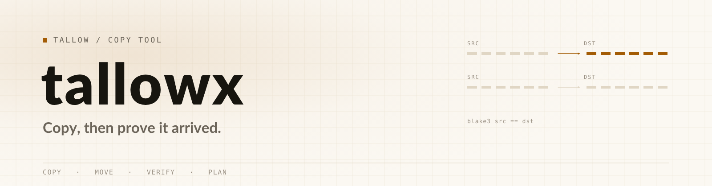
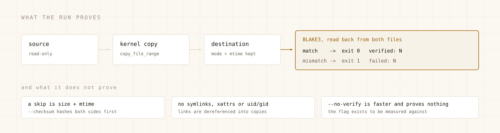

<div align="center">

<picture>
  <source media="(prefers-color-scheme: dark)" srcset="assets/tallowx-hero-dark.png">
  <source media="(prefers-color-scheme: light)" srcset="assets/tallowx-hero-light.png">
  
</picture>

**A verified copy/move tool for local disks and mounted NAS storage, written in [Tallow](https://github.com/aamirmanisa/Tallow-Language).**

<sub><a href="#quickstart">Quickstart</a> &nbsp;·&nbsp; <a href="#what-the-run-proves">What it proves</a> &nbsp;·&nbsp; <a href="#commands">Commands</a> &nbsp;·&nbsp; <a href="#benchmarks">Benchmarks</a> &nbsp;·&nbsp; <a href="#what-is-not-guaranteed">Limits</a> &nbsp;·&nbsp; <a href="#repository">Repository</a></sub>


[](https://github.com/aamirmanisa/Tallow-Copy/actions/workflows/ci.yml)

</div>

---

`tallowx` copies a file or a whole tree, then proves the copy by hashing the bytes that actually
landed on disk. It reports whether mode and mtime survived, skips files that are already identical,
and prints one machine-readable summary line. It runs wherever the Tallow engine runs.

It does **not** claim a speed win over `cp` or `rsync`. Measured here, it is at parity with `cp` for
bulk data and several times slower for many small files. The reason to use it is the evidence it
leaves behind, not the stopwatch. Numbers below, including the ones that argue against it.

```console
$ ./tallowx copy /mnt/nas/photos /mnt/backup/photos
copy  /mnt/nas/photos/readme.txt -> /mnt/backup/photos/readme.txt
copy  /mnt/nas/photos/2024/img_0003.jpg -> /mnt/backup/photos/2024/img_0003.jpg
…

copy: 4 file(s), 6600006 bytes, 22 ms
  verified: 4 | metadata preserved: 4 | skipped: 0 | failed: 0
  throughput: 286 MiB/s
```

## Quickstart

You need the Tallow engine (`tallow` on `PATH`) and the libraries it links against.

```console
# Debian / Ubuntu — clang is a run-time dependency, not just a build-time one
$ sudo apt-get install -y clang liblzma-dev libbz2-dev
$ curl -fsSL https://raw.githubusercontent.com/aamirmanisa/tallowsphere/main/install.sh | bash
```

On Arch/CachyOS: `sudo pacman -S clang xz bzip2`, the same installer, then `cd packaging/arch &&
makepkg -si` for the tool itself — the PKGBUILD refuses to build without the engine rather than
failing halfway. Without `liblzma`/`libbz2` the installer's probe fails to link and exits non-zero
(found the hard way in this repo's CI).

```console
$ git clone https://github.com/aamirmanisa/tallow-copy tallowx && cd tallowx
$ ./tallowx plan  SRC DST     # what would be copied; writes nothing
$ ./tallowx copy  SRC DST     # copy, then verify by re-reading both sides
$ ./tallowx verify SRC DST    # re-check an existing destination
```

Or without the launcher:

```console
$ tallow run tallowx.tl -- copy SRC DST
```

## What the run proves

<picture>
  <source media="(prefers-color-scheme: dark)" srcset="assets/tallowx-verify-dark.png">
  <source media="(prefers-color-scheme: light)" srcset="assets/tallowx-verify-light.png">
  
</picture>

With verification on — the default — every copied file is hashed twice from disk, source and
destination, with BLAKE3, and compared. A mismatch fails the file and the run exits `1`. Mode bits
and mtime are preserved by the copy primitive and counted. A file that cannot be copied fails
loudly; the run never reports success with a missing file.

## Commands

```text
tallowx plan   SRC DST                  # what would be copied; writes nothing
tallowx copy   SRC DST [--delete] [--exclude P] [--resume] [--checksum] [--no-verify] [--json]
tallowx move   SRC DST [--resume] [--no-verify] [--json]
tallowx verify SRC DST                  # re-check an existing destination
```

| Flag | What it does | When it is the right flag |
|---|---|---|
| `--checksum` | hashes both sides before skipping an existing destination | when the destination may have been damaged in place without changing size or mtime |
| `--delete` | mirrors: copies what is missing or changed, then removes what the source does not have | a backup that should converge, not accumulate |
| `--exclude P` | with `--delete`, protects an exact path, a directory prefix, or a `*suffix` | keeping `*.tmp` or a local `cache/` out of the prune |
| `--resume` | completes a short destination from a hash-verified prefix | a slow or flaky link with a large tail, not a local disk (measurement below) |
| `--no-verify` | skips the BLAKE3 read-back | when you want the copy time and nothing else; it proves nothing |
| `--json` | one summary object, per-file lines suppressed | anything that parses the result |

`SRC` may be a file or a directory; `DST` may be any mounted filesystem — ext4, XFS, btrfs, ZFS,
NFS, SMB/CIFS, sshfs. Nothing in the tool is local-filesystem specific: it uses the kernel's copy
path and the mounted path you give it.

**Exit codes.** `0` ok · `1` failure or verification mismatch · `2` usage.

### Why there is no `--workers` flag

There used to be one. It split the file list into `spawn`ed slices and measured **8.55 s against
7.63 s** for the sequential path on 4,000 files — slower, because the interpreter serialises
evaluation and the parent spins while waiting on the stat files the workers write. It was removed
rather than shipped as a switch that implies a speedup it does not deliver: `spawn` with a
`[]String` parameter is also interpreter-only, so the flag was the single thing preventing
`tallowx` from compiling natively at all.

## Mirroring a destination (`--delete`)

`copy --delete` makes DST match SRC. That is the mode a backup actually runs in — a copy that only
ever adds turns a renamed file into two files, forever.

```sh
tallowx copy ~/photos /mnt/nas/photos --delete --exclude '*.tmp'
tallowx plan ~/photos /mnt/nas/photos --delete      # shows the prunes, writes nothing
```

Deleting is the one thing here a re-run cannot undo, so it refuses before it starts rather than
discovering the mistake half way through:

- **Plan first is free.** `plan --delete` prints every `prune` line and writes nothing — the same
  tree walk, no side effects.
- **Identical, nested or inverted paths are refused**, as is `move --delete` (which would empty the
  source by definition) and a single-file source.
- **An empty source cannot empty the destination.** If SRC has no files and DST has some, that is
  far more likely a mistyped path than an intent; it refuses unless you pass `--allow-empty`.
- **A failed copy cancels every prune in that run.** A prune is the only part of a run that destroys
  data, so it does not happen on the strength of a run that already failed.
- **Directories go only when empty.** Files are removed first; a directory is deleted only after
  `list_dir` says it holds nothing, so a kept file's parent is never taken out from under it.

`--exclude P` (repeatable) is deliberately not a pattern language: an exact relative path, a
directory prefix (`cache` protects `cache/…`), or a trailing `*` suffix (`*.tmp`). Every shape here
is one the test suite can check exhaustively, and an untested shape in a delete path is how data
goes away. Excluded files are never deleted *by* a parent directory's removal either, because the
directory is only removed once empty.

## Resuming an interrupted copy (`--resume`)

A transfer that dies half way leaves a short destination. With `--resume`, a file of 8 MiB or more
is completed rather than restarted: the bytes already present are hashed (`Transfer.hash_prefix`)
and compared with the source's first N bytes, and only if they match is the remainder appended
(`fs.copy_range`). A destination that is not a provable prefix — stale, torn, or from a different
source — is deleted and copied whole. The tool never appends to bytes it could not prove, because
size alone cannot tell "half this file" from "the wrong half of another one".

**Measured on a 256 MiB file, 90% already present, native binary, 3 runs each:**

| | with verification | without |
|---|---|---|
| `copy` | 994–998 ms | 223–226 ms |
| `copy --resume` | 1284–1434 ms | 527–535 ms |

Resume is *slower* on local storage in every configuration — 30% with verification, 2.3× without.
Proving the prefix costs two full-length reads (source and destination, hashed), while re-copying
costs one kernel copy of the whole file: the check reads more than the copy writes.

So it is opt-in, and the honest recommendation is to leave it off for local disks. It can only pay
when the destination is on a slow or flaky link *and* the tail is large — an upload to a NAS over a
congested link, where re-sending 256 MiB costs minutes and re-reading 90% costs less. Measure your
case before trusting it.

`copy_range` carries the source's mtime, so a resumed file is indistinguishable from a whole-file
copy on the next run and is skipped rather than re-copied. The summary prints `resumed: N` when the
path was used; the JSON carries `"resumed": N`.

`--resume` requires an engine with `fs.copy_range` and `Transfer.hash_prefix` — tallowsphere 1.5.5,
the first released tarball with them (the primitives landed in `8883409`). On an older engine the
flag fails loudly (`undefined function: fs.copy_range`) and the suite skips the resume cases with a
message instead of pretending they ran. Every other path — copy, verify, move, plan — works on any
1.5.x engine.

## Benchmarks

Two datasets, two planes, one machine. Median of 3 runs per tool, destination removed between runs,
every output checked byte-identical to the source. Raw numbers in
[`bench/results.json`](bench/results.json); reproduce with `python3 bench/bench.py`.

Host: 8-core ARM64, ext4, 16 GB RAM, page cache warm, load average 3.0–6.7 during the runs (the box
was compiling), so treat these as an upper bound on wall time rather than a lab figure.

**A — 4,000 files × 200 B (16 MB, 40 dirs)**

| Tool | Min | Runs |
|---|---|---|
| `tallowx` native, verify | 314 ms | 318, 314, 316, 325, 324 |
| `tallowx` native, `--no-verify` | 259 ms | 264, 259, 269 |
| `tallowx` interpreter | 1,176 ms | 1,215, 1,176, 1,227 |
| `cp -a` | 141 ms | 145, 144, 144 |

**B — 1,000 files × 200 KB (196 MB, 10 dirs)**

| Tool | Min | Runs |
|---|---|---|
| `tallowx` native, verify | 684 ms | 689, 702, 684 |
| `tallowx` native, `--no-verify` | 235 ms | 235, 248, 246 |
| `tallowx` interpreter | 876 ms | 878, 897, 876 |
| `cp -a` | 195 ms | 195, 201, 196 |

An earlier harness run on the interpreter-only engine (1.5.2) put `rsync -a` 3.02× behind `cp` on a
single 256 MiB file, and `tallowx` 4.30× behind it with verification, 1.07× behind without. Those
rows stay in `bench/results.json` rather than in a second table here.

Reading them honestly:

- **`cp -a` is the like-for-like row for `--no-verify`** — neither hashes anything: 259 vs 141 ms on
  16 MB, 235 vs 195 ms on 196 MB.
- **Verification costs 55 ms on 16 MB and 450 ms on 196 MB** (both sides read and hashed, ~870 MB/s
  aggregate on the large set).
- **Bulk copy is at parity with `cp`** because both end up in the kernel's copy path
  (`copy_file_range` / sendfile). There is no userspace fast path to win here.
- **The interpreter loses most on many small files** (1.18 s vs 314 ms, 3.7×) and only 1.3× on the
  large-file shape, where hashing dominates both.
- A cold run of the same 196 MB tree took 1,729 ms end to end at 112 MiB/s — I/O bound, which is
  what a real first transfer of that size looks like.
- **The 16 MB row is not stable.** An earlier run of the same binary reported 92–109 ms for the same
  tree, a 3× spread that never reproduced; treat ~300 ms as the number and the fast outlier as
  dentry-cache luck.
- **The biggest win was not in this program.** Native binaries link the newest `libtallow.a` on
  disk; when the engine is built in debug, that archive is the debug runtime and every FFI call runs
  unoptimized. Hashing 200 MB took 3,768 ms that way and 436 ms against a release engine — a 10.4×
  difference caused entirely by which archive the linker picked. Build the engine with `--release`
  first.

Never benchmark through `tallow run`: it compiles first, so the number you get is clang's.

## Two planes

The same source compiles to a native binary and runs on the interpreter. The engine that first built
it natively still printed `1.5.2` while carrying the nine codegen fixes in
[`docs/ENGINE-FINDINGS.md`](docs/ENGINE-FINDINGS.md) — which is why the suites probe capability by
execution instead of trusting a version string. Releases from 1.5.5 onward state the version
correctly, and 1.5.7 keeps the payload kind through `?`.

```text
./tallowx …                         # native if build/tallowx is newer than tallowx.tl, else interpreter
TALLOWX_PLANE=native ./tallowx …    # refuse to run on the interpreter
TALLOWX_PLANE=interpret ./tallowx … # force the interpreter
```

Build it with the script, which writes into `build/` — `tallow build` puts the binary beside its
source, and building `tallowx.tl` in the repo root would overwrite the launcher with a ~110 MB ELF:

```console
$ ./scripts/build-native.sh
build-native: tallow 1.5.7 -> build/tallowx
build-native: ok — tallowx 0.2.0
```

The script records the engine version in `build/engine-version`, and the launcher compares it on
every run. A binary built by an engine that is no longer installed is not run: the engine is part of
the binary's semantics, and a debug-built engine links an unoptimised archive that makes every FFI
call ~10× slower. On a mismatch the launcher prints the reason and falls back to the interpreter;
`TALLOWX_PLANE=native` turns that into a refusal.

## Verification

| Gate | Result | Measured |
|---|---|---|
| `tallow check tallowx.tl` | check passed: 28 items, **0 warnings** | 2026-10-26 · engine `main` `62801d4` (3 warnings on 1.5.7) |
| `tests/smoke.sh` — interpreter plane | 29 checks, 0 failed | 2026-10-25 |
| `tests/native.sh` — compiled binary | 29 checks, 0 failed | 2026-10-25 |
| `packaging/arch/verify-recipe.sh` | PASS — builds a 110,815,672-byte binary, assembles a 4-file package, and the installed binary copies a file from outside the tree | 2026-10-26 · engine 1.5.7 |

```console
$ tallow check tallowx.tl
$ TALLOW=$(command -v tallow) ./tests/smoke.sh    # fixtures, both planes' behaviour
$ TALLOW=$(command -v tallow) ./tests/native.sh   # builds, then the same suite
```

`tests/native.sh` skips cleanly when the engine cannot lower the program, and says so rather than
counting a skip as a pass. Both scripts build their own fixtures under a temp directory: no network,
no privileged operations.

## What is not guaranteed

- **Symlinks are dereferenced, not preserved.** A link becomes a copy of its target; dangling links
  are reported and skipped.
- **Ownership (uid/gid) and xattrs/ACLs are not preserved.** The run is done as the invoking user;
  `--preserve=all` semantics are out of scope.
- **A skip is size + mtime, not proof of sameness.** That is what makes a second run of a large tree
  cheap, and it will also skip a destination damaged in place if the damage preserved size and
  mtime. `--checksum` turns every skip into a two-hash comparison (twice the reads, still no
  writes); `verify` is the full-tree check. The default is the fast guess, deliberately.
- **Resume is opt-in by size, and only for provable prefixes**, as measured above.
- **A hard I/O error aborts the run.** `FileCopy.copy_metadata` returns a value rather than a
  `Result`, so a failure surfaces as a runtime error. The engine now also offers `copy.try_file`,
  which does return `Result<CopyStats>` and keeps a batch going; it does not preserve metadata,
  which is why this tool does not use it yet.
- **On engines up to 1.5.7, three `warning[W0102]` lines are expected and are not errors**: the
  checker reported the `FileCopy` namespace and a top-level `const` as possibly undefined. Fixed in
  the engine's `main` (`62801d4`) — on that build `tallow check` reports 0 warnings — but a released
  engine still prints them. The engine's plane marker (`* native build unavailable …`) appears on
  the interpreter path and is informational; `2>/dev/null` silences both.
- **Non-ASCII string literals were mangled by engine releases up to 1.5.7** [measured 2026-10-25 ·
  1.5.7]: the lexer decoded each UTF-8 byte as a Latin-1 character, so `—` printed as `â€"`. It is
  fixed in the engine's `main` (`src/lexer.rs`, with a regression test); until a release carries that
  fix, this tool keeps its own output strings ASCII so a released engine renders them correctly.

## Repository

```text
tallowx.tl                the tool — one Tallow program, 696 lines
tallowx                   launcher: native build if fresh and engine-matched, else tallow run
scripts/build-native.sh   builds into build/ and records the engine that built it
tests/smoke.sh            end-to-end checks against SRC/DST fixtures
tests/native.sh           the same fixture suite against a compiled binary
bench/bench.py            benchmark harness → bench/results.json
packaging/arch/           PKGBUILD, and a verifier for boxes without makepkg
docs/DESIGN.md            architecture and decisions
docs/ENGINE-FINDINGS.md   engine defects and gaps found while building this
docs/PRIOR-ART.md         what other transfer tools do, and what was not researched
docs/OPTIMIZATION-REPORT.md  measured analysis, prioritised engine work, gates
assets/                   hero and verification diagrams (SVG sources + PNGs)
```

[`docs/README.md`](docs/README.md) indexes those four documents.

## Prior art and scope

`tallowx` sits next to tools that already solve parts of this problem: `cp --reflink`, `rsync`,
`rclone`, `bbcp`, `fpart`/`GNU parallel`, `tar`+pipe, and the content-addressed end of the field
(`magic-wormhole`, `croc`, `Syncthing`, `NNCP`). [`docs/PRIOR-ART.md`](docs/PRIOR-ART.md) records
what each one is good at and what was taken from it.

This project did **not** research intrusion techniques, exfiltration tradecraft, or material from
closed criminal forums. The requirement that motivated it is plain: move bytes to a NAS and be able
to prove afterwards that the bytes arrived unchanged.

## Licence

MIT — see [`LICENSE`](LICENSE).
